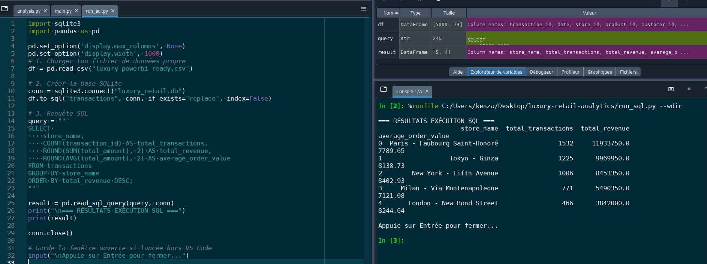

# 💎 Luxury Retail Analytics — Performance & Client Segmentation Dashboard

<p align="center">
  
</p>

---

## Executive Summary

This project delivers an end-to-end business intelligence solution tailored for high-end luxury houses (*Maison de Luxe*). Designed to align with the analytical standards of leading prestige groups like **LVMH, Hermès, and Kering**, this interactive platform synthesizes flagship boutique performance, category distribution, average order value (AOV), and high-net-worth client dynamics (VIP / VIC segmentation).

The architecture spans the full data analytics lifecycle:
1. **Data Engineering & Preparation** via Python (`pandas`, `numpy`).
2. **Relational Querying & KPI Extraction** via SQL (`sqlite3`).
3. **Interactive Executive Visualization** via Power BI (*Minimalist Dark & Gold Theme*).

---

## 🛠️ Technical Architecture & Stack

| Layer | Technology | Usage & Functionality |
| :--- | :--- | :--- |
| **Data Engine** | `Python 3.10+` | Dataset orchestration, transaction modeling, schema normalization |
| **Database** | `SQL (SQLite / PostgreSQL)` | Relational querying, aggregation, client tier distribution |
| **Visual Analytics** | `Power BI Desktop` | Interactive dashboarding, dynamic slicers, DAX measures |
| **Documentation** | `Markdown / VS Code` | Technical reporting and executive insights |

---

## 📊 Business Metrics & Key Performance Indicators

* **Total Revenue:** `€40.00M`
* **Average Order Value (AOV):** `€7,940`
* **Top Flagship Location:** `Paris — Faubourg Saint-Honoré (€12M)`
* **Core Product Category:** `Leather Goods / Maroquinerie (67.22%)`
* **Client Segmentation:** High contribution from VIP & Very Important Clients (VIC) relative to total volume.

---

## 💻 Relational Database Interrogation (`queries.sql`)

```sql
-- ============================================================
-- LUXURY RETAIL ANALYTICS — EXECUTIVE QUERIES
-- ============================================================

-- 1. Revenue & Average Order Value (AOV) by Flagship Boutique
SELECT 
    store_name,
    COUNT(transaction_id) AS total_transactions,
    ROUND(SUM(total_amount), 2) AS total_revenue,
    ROUND(AVG(total_amount), 2) AS average_order_value
FROM transactions
GROUP BY store_name
ORDER BY total_revenue DESC;

-- 2. Top 5 Revenue-Generating Product Identifiers
SELECT 
    product_id,
    category,
    COUNT(transaction_id) AS units_sold,
    ROUND(SUM(total_amount), 2) AS total_revenue
FROM transactions
GROUP BY product_id, category
ORDER BY total_revenue DESC
LIMIT 5;

-- 3. Revenue Distribution by Client Loyalty Tier (VIP / VIC / Standard)
SELECT 
    tier,
    COUNT(DISTINCT customer_id) AS total_customers,
    ROUND(SUM(total_amount), 2) AS total_revenue,
    ROUND(SUM(total_amount) * 100.0 / (SELECT SUM(total_amount) FROM transactions), 2) AS revenue_percentage
FROM transactions
GROUP BY tier
ORDER BY total_revenue DESC;
```

---

## 🎯 Strategic Business Recommendations

### 1. Capitalization on the Paris Faubourg Saint-Honoré Flagship
* **Finding :** Paris outperforms all international retail locations with €12M in revenue.
* **Action :** Analyze key success factors (stock allocation, in-store client experience, Client Advisor training) to model and replicate these best practices across Tokyo-Ginza and New York-Fifth Avenue.

### 2. VIC (Very Important Client) Retention & Engagement Strategy
* **Finding :** VIP and VIC client segments represent a disproportionate revenue driver relative to the total buyer count.
* **Action :** Strengthen exclusive clienteling programs (private VIP salon bookings, fashion show invitations, early access to haute maroquinerie pieces).
  
### 3. Product Mix Diversification (Cross-Selling)
* **Finding :** Leather goods alone account for over 67% of total global revenue.
* **Action :** Develop targeted cross-selling strategies during iconic bag purchases to guide clients toward ready-to-wear, watchmaking, or high jewelry.
  
### 4. Action Plan for High-AOV Boutiques
* **Finding :** Certain boutiques display lower transaction volumes but maintain very high average order values (AOV).
* **Action :** Adapt visual merchandising and product assortments specifically for locations like London - New Bond Street and Milan to maximize ultra-high-value sales.
---

<p align="center">
  <i>Designed for Executive Analytics & Luxury Retail Strategy</i>
</p>
